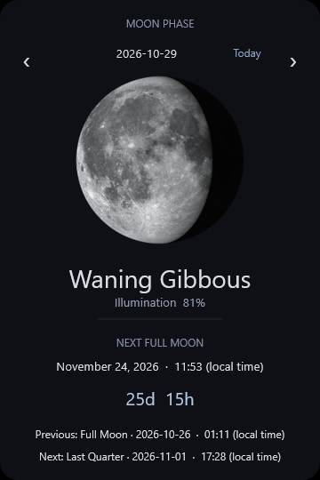

# Lunar

A quiet, offline Moon phase widget for Rainmeter on Windows 11. Real lunar
surface imagery, current illumination, the next full moon in your local time,
and a days/hours countdown. English and Spanish, compact and expanded layouts,
and optional visual reminders.



This is an actual isolated Rainmeter 4.5.28 window capture on Windows 11, not a
mockup. Values reflect the capture time, not the time you read this page. The
rounded panel is translucent; the capture displays it against black.
[Spanish compact capture, southern orientation at 1.5×](docs/previews/compact-es-south-windows11.png).

## Install

Requires Rainmeter **4.5.20 or newer**, Windows 11; no additional runtime.
Validated on Rainmeter 4.5.28 (64-bit). Download Rainmeter only from
[rainmeter.net](https://www.rainmeter.net/). Installing Rainmeter itself may ask
for elevation; installing or running this skin does not.

1. Extract the release ZIP and inspect its `Lunar` folder. Alternatively, use
   the `skin/Lunar` folder from this repository.
2. Open Rainmeter → Manage → Settings to locate your skins directory (normally
   `Documents\Rainmeter\Skins`). Copy the **Lunar** folder there. The resulting
   path must be `Skins\Lunar\Lunar.ini`.
3. In Manage, click **Refresh all**, select `Lunar\Lunar.ini`, and click **Load**.
4. Drag the widget into position. Rainmeter remembers its position. Right-click
   → Settings provides normal positioning, click-through and transparency.

Edit `Lunar\@Resources\Settings.inc`, then right-click the widget → Refresh skin.
For Santiago, set `Latitude=-33`; choose your normal Windows local time zone
(`Pacific SA Standard Time`, shown as Santiago). **Latitude does not set the
time zone.** The default `Latitude=0` uses the northern visual convention.

For a `.rmskin` release, inspect it with an archive viewer, then double-click
and install using Rainmeter. This repository's automated build produces an
inspectable manual-install ZIP. The documented [release workflow](release/README.md)
uses Rainmeter's official Skin Packager to create a genuine `.rmskin`.

To uninstall, unload `Lunar` in Manage and remove its folder. No service, task,
registry entry or startup item is created by the skin. Back up Settings.inc and
NotificationState.dat before upgrading; preserve both to retain preferences and
reminder history.

## Use and configure

Use **‹ / ›** to browse one calendar day backward/forward. The Moon, illumination,
phase name and lunar event details update immediately for the selected date at
**12:00 local time**. The header says **PREVIEW** while browsing; the countdown
then runs from that selected noon. Click **Today** (**Hoy** in Spanish) to return
to the current instant and automatic live updates. Refresh also returns to live.
Notifications always follow the real clock, regardless of the preview date.
[Actual future-date browsing capture](docs/previews/browse-date-windows11.png).

- Real Moon texture; waxing/waning illumination and hemisphere rotation.
- Phase name and approximate illuminated fraction, refreshed every five minutes.
- Next full moon, local calendar date/time, and countdown refreshed every 30
  seconds by default. Countdown floors to whole hours: `0d 0h` means under an hour.
- Optional previous/next primary events, hidden in compact mode.
- Scale, text/Moon opacity, independently adjustable rounded background,
  English/Spanish, date format, 12/24-hour clock and poll interval.

For a light wallpaper, set `BackgroundOpacity=220` in Settings.inc. Use `140`
for a softer panel or `0` for a transparent background. `CornerRadius=20`
controls rounding, and both settings work with compact and expanded layouts.

All settings are described in the [configuration guide](docs/configuration.md).
There is no location lookup, sign-in or internet connection.

Notifications are **disabled by default**. Opt in with `Notifications=1`. Advance
and occurrence reminders are independent, with 6/12/24/48-hour advance notice and
optional new/quarter moon events. Alerts appear **inside the widget**, persist
for ten minutes or until clicked, and are not Windows toasts. They do not fire
while Rainmeter is stopped. Missed reminders can catch up after sleep/restart
within six hours by default; stale reminders are skipped. A local numeric journal
prevents repeated reminders. See [notification details](docs/configuration.md#notifications).

## Accuracy and limitations

Primary events use Meeus chapter 49 periodic corrections, not a fixed 29.53-day
count. Times are calculated in Terrestrial Time, converted to approximate UTC
using Espenak/Meeus ΔT, and only then converted to local time using Windows.
The same event can correctly display on different calendar dates in different
countries. A future event uses the DST rules for **that event**, not today's offset.

Supported current dates: **2000–2050**. The validation threshold is **two minutes**
against independent USNO minute-resolution event tables. In the six sampled
years (298 events), the largest observed error is **45.1 seconds**; that sample
does not certify every date. Future ΔT and legal time-zone rules are predictions
and can change. This is a desktop calendar, not an observatory timing instrument.

Illumination uses a separate truncated geocentric phase-angle approximation.
Its test threshold is two percentage points; intermediate coverage is limited
to four independent daily references. It is displayed rounded to a whole percent.
The image uses 120 pre-rendered phases (maximum cycle quantization 1.5°) and a
static lunar surface. Phase labels describe eight broad angular bins.

Negative latitude rotates the whole Moon 180°: southern waxing lights the left,
southern waning the right. This is a **hemisphere approximation**, not a prediction
of the Moon's position angle above your horizon. There is no longitude, libration,
terrain shadow, eclipse rendering, or topocentric/parallactic rotation calculation.
The default near the equator is a convention, not a horizon orientation.

## Security assessment

The skin contains one INI, one settings include, four auditable Lua files and
120 local PNGs. No plugins, network measures, telemetry, external executables,
shell commands, downloads, registry changes, services, scheduled tasks or automatic
updates. The scripts read bundled files and, only when reminders are enabled,
read/append `@Resources/NotificationState.dat`. State is parsed as numeric text,
never executed. Settings persist in the user's local include file.

Lua loads only fixed, bundled module paths; it does not execute code from user
data or remote content. Fixed UI callbacks dismiss alerts, browse dates and
restore Today; no user text is interpreted as executable code.
Skins run with Rainmeter's user permissions, so review code before installation
and protect your skin directory from untrusted edits. An unwritable state journal
suppresses alerts and logs a warning instead of risking duplicates.
The [security review](SECURITY.md) lists every script and development endpoint.

## Develop and validate

Normal users **do not need Node or npm**. Contributors use Node 22+:

```text
npm ci --ignore-scripts
npm test
npm run assets
npm run package
```

Tests and rendering work offline after the locked development dependencies are
installed. `npm test` executes the production Lua modules with Fengari (Lua 5.3
semantics), checks the saved USNO references, Chilean DST, countdown/reminder
boundaries, and PNG lighting. Native Rainmeter Lua 5.1 testing is separate.

See [architecture](docs/architecture.md), [validation and manual checklist](docs/validation.md),
[contributing](CONTRIBUTING.md), and [release packaging](release/README.md).
Code: [MIT](LICENSE). NASA imagery and USNO references: [credits and notices](NOTICE.md).
