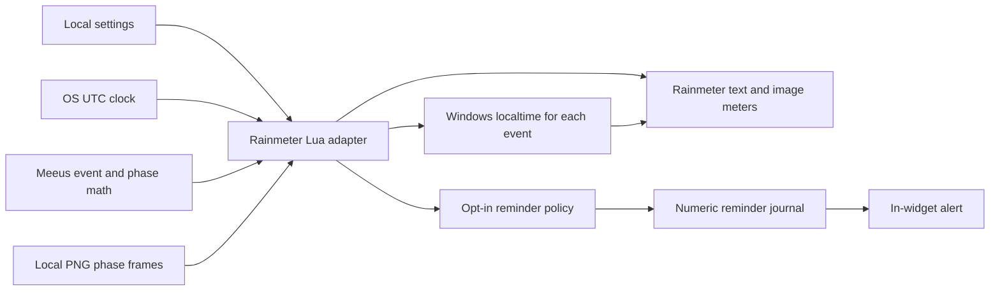

# Architecture and research decisions

Reviewed against official online Rainmeter documentation on 2026-10-29. The
installed integration target is stable Rainmeter 4.5.28, not a 5.0 prerelease.
The skin stays within the Lua 5.1 API supported by Rainmeter 4.5; no compiled
Lua modules or `require` are needed.

## Approach comparison

| Approach | Accuracy | Cost/maintenance | Security |
| --- | --- | --- | --- |
| Mean 29.53059-day cycle | Can miss events by hours | Very small | Offline, but inadequate timing |
| Online phase API | Depends on provider; potentially accurate | Network, outages, endpoint maintenance | Sends requests; avoidable runtime dependency |
| Bundled event tables | Good within covered dates | Periodic releases; finite data | Offline; grows over time |
| Full numerical ephemeris | Highest potential accuracy | Large data/library and time-scale work | Extra code and assets |
| Meeus periodic phase equations | Suitable for calendar event times | Small, auditable math | Offline; selected |

Selected: chapter 49 periodic equations for primary events and chapter 48
truncated phase angle for approximate current illumination. These are distinct
calculations with distinct limitations. No fixed-period event extrapolation is
used: the mean period only seeds a search for nearby lunation numbers. The
periodic solar/lunar corrections are applied separately to every event.

## Runtime flow

`skin/Lunar/Lunar.ini` owns typography, geometry and meters. Settings.inc contains
preferences. `@Resources/Scripts` contains:

- **Astronomy.lua:** pure calculations; UTC/Gregorian helpers; event lookup;
  phase fraction, phase/image selection; countdown. No Rainmeter dependency.
- **Format.lua:** English/Spanish labels, date formatting; an injectable
  date provider for tests. Production uses Windows `os.date` for each event.
  Unicode character variables bridge Rainmeter 4.5's ANSI Lua bang boundary.
- **Alerts.lua:** pure due-reminder policy plus numeric journal IO. No network,
  process launch, code interpretation or time-zone arithmetic.
- **Widget.lua:** validates settings, loads the three fixed local modules,
  caches results and assigns meter options. Fixed mouse actions invoke dismiss,
  previous/next day and Today callbacks; no text is interpolated into executable Lua.

Date browsing stores a selected local noon and its own cached event list in
memory. Calendar stepping uses `os.date` plus `os.time` with a fresh local table
and no forced DST flag; it never adds a fixed 86400 seconds. Display calculations
use the selected timestamp, while notification policy continues to use the real
UTC clock and real cached events. The UI labels previews explicitly. Today and
refresh discard the selected date and force an immediate image/text update.

Rainmeter updates the script once a second. The early-return path reads only the
clock until the configured 5–300-second data poll is due (default 30). Event
lists contain five lunations and refresh once per day or after a sufficiently
large clock jump. Phase math and the image path refresh every five minutes.
Data polls format local dates again, allowing OS time-zone changes to appear.
There are no file reads per normal tick, and journal writes occur only for
newly delivered reminders. Meters update/redraw only when the data poll runs.
No CPU/RAM benchmark is claimed; Rainmeter owns the renderer and image cache.

## Astronomical time scales

Meeus returns Julian Ephemeris Dates in TT. The code subtracts the
Espenak/Meeus ΔT polynomial to obtain UT1, approximated as UTC at the widget's
two-minute validation threshold. UT1 versus UTC contributes under a second in
modern maintained UTC; the ΔT model is a larger uncertainty for future dates.
The 2005–2050 polynomial was a historical forecast and differs from observed
modern ΔT. This release deliberately documents and tests the resulting
calendar-level tolerance rather than claiming second accuracy.

Public event times and reminder decisions are Unix UTC-like seconds. Gregorian
dates convert without `os.time(table)`, which would interpret them as local.
Only final display calls Windows localtime. Countdown subtracts UTC timestamps,
so DST transitions never create a spurious hour. Supported current dates are
2000–2050; outside that range the widget shows a support-range message instead
of claiming supported results.

## Rendering and orientation

`tools/render.cjs` projects NASA's 2019 1024×512 equirectangular LROC/LOLA color
map onto a fixed near-side sphere. It bakes 120 transparent 256×256 PNGs with a
spherical terminator, softened lighting and slight artistic earthshine. A
contact sheet is a generated **asset preview**, not a desktop screenshot.
This avoids per-pixel runtime work, third-party render plugins and generated
files in the user's skin directory. Only the selected image is referenced by
the meter; Rainmeter controls its actual image-cache retention.

The signed phase cycle selects waxing/waning illumination. Texture and lighting
rotate together by 180° when configured latitude is negative. This conventional
hemisphere switch is deliberately simpler than calculating the observer's
parallactic angle. It does not depict longitude-dependent horizon tilt,
libration, local topography, eclipse shadows, or lunar visibility above the horizon.

## Notifications and persistence

The supported native Lua/skin interface has no documented Windows toast API.
`!Log` is a Rainmeter diagnostic, not a user toast. Adding COM/WinRT toast support
would require a plugin/helper with identity/registration concerns; shell helpers
would violate the desired runtime constraints. Thus notifications are optional
in-widget messages, with no OS background registration.

Each event ID is `integer-lunation:quarter`. A reminder adds `:advance-hours`;
zero denotes the occurrence reminder. Records are plain numeric lines, validated
on read. A successful write and close precede display. This chooses possible
loss of an alert after a crash over intentional repeated delivery. Normal
refresh/restart deduplication is tested. The file is small (roughly a few KB
per year even for all phases); no code-loading or aggressive pruning is needed.
Disk-cache power-loss and concurrent-process limitations are documented in the
configuration guide. Notifications create no state file when disabled.

## Sources

- [Official Lua scripting/API and restrictions](https://docs.rainmeter.net/manual/lua-scripting/)
- [Script measure](https://docs.rainmeter.net/manual/measures/script/)
- [Image meters](https://docs.rainmeter.net/manual/meters/image/) and
  [image rotation/alpha](https://docs.rainmeter.net/manual/meters/general-options/image-options/)
- [Rainmeter commands](https://docs.rainmeter.net/manual/bangs/)
- [Official skin distribution format](https://docs.rainmeter.net/manual/distributing-skins/)
- Jean Meeus, *Astronomical Algorithms*, second edition, chapters 48–49.
- [Sonia Keys' MIT chapter 49 implementation](https://github.com/soniakeys/meeus/blob/master/v3/moonphase/moonphase.go)
- [NASA Espenak/Meeus ΔT model](https://eclipse.gsfc.nasa.gov/SEhelp/deltatpoly2004.html)
- [NASA century phase table, time-scale notes and variable cycle length](https://eclipse.gsfc.nasa.gov/phase/phases2001.html)
- [Independent USNO event definitions and data](https://aa.usno.navy.mil/data/MoonPhases)
- [USNO API documentation](https://aa.usno.navy.mil/data/api.html)
- [NASA CGI Moon Kit and credits](https://svs.gsfc.nasa.gov/4720/)
